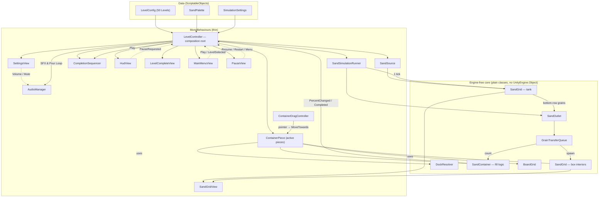
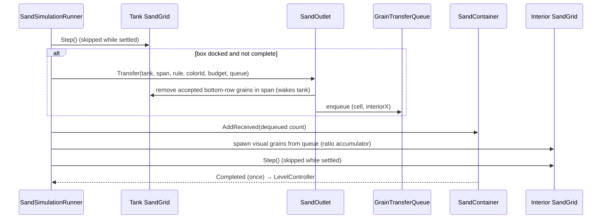
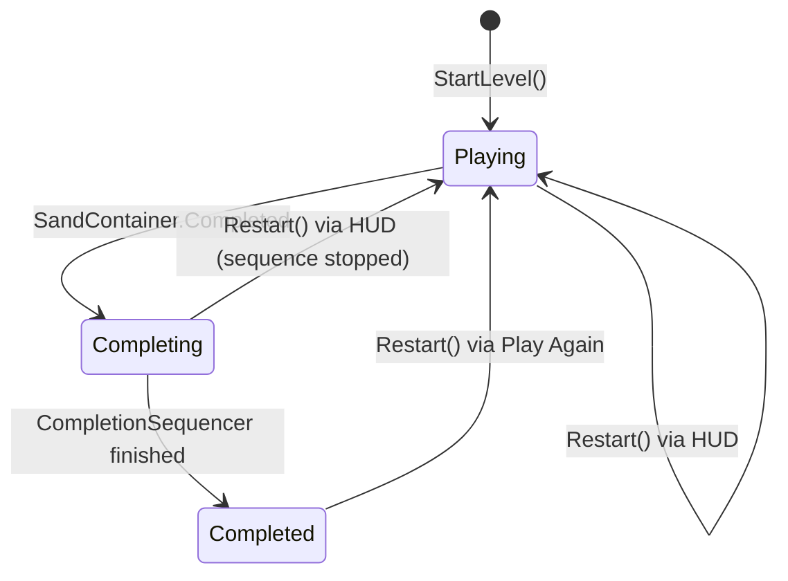

# Architecture — Color Sand Prototype

> **Status:** **implemented and verified in the Unity Editor** (2026-10-07). M0–M6 are done, and this file describes the as-built code. On-device work (M7) and the submission deliverables (M8) are pending; see [roadmap.md](roadmap.md).
> **Precedence:** AGENTS.md §2–12 and CODE_FORMAT_STANDARDS.md override anything in this file.
> **Context:** see [project-overview.md](project-overview.md) for the brief and the reference-game analysis.

## 1. Design goals and constraints

| Goal | Consequence for the design |
|---|---|
| Convincing sand: fall, slide, pile, slump; colored grains with per-grain tone | Cellular-automaton grid with one cell per grain; tones stored per grain, so patterns deform naturally |
| Drag one box; docking opens the path, undocking closes it | Continuous dock detection from the box position; the outlet span is computed every frame |
| Visible, progressive fill and a satisfying completion | Sand inside the box is simulated, not a fill bar; a scripted completion sequence with eased curves |
| Instant, repeatable restart | Every subsystem has a `Reset…`/`Initialize…` path; no scene reload needed |
| 60 FPS on mid-range Android | No GameObject per grain; fixed tick that sleeps when settled; one small texture upload per changed grid; zero steady-state GC |
| Clean, explainable code within 2 days | Pure C# core (testable in EditMode), thin MonoBehaviours, ScriptableObject data, C# events, no speculative abstractions (AGENTS.md §11) |

## 2. System overview



### 2.1 Per-frame order

Script execution order is enforced with `[DefaultExecutionOrder]`:

| Order | Component | Work |
|---|---|---|
| −100 | `ContainerDragController.Update` | Poll pointer; select/drag/release the box; move it under board constraints |
| −90 | `ContainerPiece.Update` | Smooth follow; recompute `DockState` (docked? outlet span); raise `PathOpened`/`PathClosed` on change |
| 0 | `SandSimulationRunner.Update` | Run 0–N fixed ticks (pipeline in §2.2) |
| LateUpdate | `SandGridView.LateUpdate` ×2 | Upload a grid to its texture if its `Version` changed |
| events | `ContainerLabelView`, `LevelController`, VFX | React to `PercentChanged`, `Completed`, `PathOpened`, `PathClosed` |

### 2.2 One simulation tick



## 3. Spaces, units and default layout

| Space | Definition |
|---|---|
| Board cell | `(column, row)`, row 0 at the bottom. The **dock row** is the top row (`row = rows − 1`). |
| World | 1 board cell = **1 world unit**, board origin at its bottom-left, gameplay on the z = 0 plane, orthographic camera. |
| Grain | `G = grainsPerCell` grains per board-cell edge. **Default 24**, tunable 20–32 in M2. Target: 5–7 px per grain on a 1080-px-wide screen; the reference is ~25–33 grains per cell. |
| Grid-local | `(x, y)` with y = 0 the bottom row; row-major index `i = y * width + x`. Out of bounds counts as solid. |
| World → tank grain x | `x = floor((worldX − tankInteriorMinX) * G)` |

### 3.1 Default level (data in `LevelConfig`, not hard-coded)

| Element | Cells | Grains at G = 24 |
|---|---|---|
| Board | 6 × 7 | — |
| Tank interior: sits on the board's top edge, full board width | 6 × 2 | 144 × 48 = 6,912 cells; ~75 % filled ≈ **5,184 grains** |
| Box (open-top container) | 2 × 2 footprint | side walls 4, front face 5, rim 3 grains → opening **40** wide; interior 40 × 40 = **1,600** cells, plus 3 rim (headroom) rows (grid 40 × 43) |
| Box start cell | (2, 0) | bottom-middle |
| Walls | none (supported) | — |

```
 world y
   9 ┌──────────────── tank interior 6×2 (144×48 grains) ────────────────┐
     │░░░░░░░░░░░░░░░░░░ sand (pattern per D-005) ░░░░░░░░░░░░░░░░░░░░░░│
   7 └───────────────────────────── dock line ─────────────────────────────┘
     │    │    │ ▄▄▄▄▄▄▄▄▄ │    │    │   ← dock row (row 6): a box here is docked
     │    │    │ box 2×2   │    │    │      outlet span = box opening ∩ tank
     ...
   0 └────┴────┴───────────┴────┴────┘
     x=0                             x=6
```

The tank's decorative bottom lip is drawn in the top part of the dock row, **behind** boxes. A docked box covers it, as in the reference (Level 3, 0:39).

## 4. Sand simulation core

### 4.1 Cell encoding

Each cell is one `ushort`, so a grid is a single `ushort[]` (tank: 6,912 cells = 13.8 KB). A value of zero is an empty cell.

| Bits | Field | Values |
|---|---|---|
| 0 | Occupied | 1 = grain |
| 1–4 | Tone | 0–14: shadow → base → highlight ramp; 15 = sparkle |
| 5–10 | Color id | 0–63, index into `SandPalette` |
| 11–15 | Reserved | 0 |

- Bits 1–10 together are the tone-LUT index (`colorId * 16 + tone`), so rendering costs one shift and one array read per cell.
- `SandCell` provides `CreateGrain`, `IsGrain`, `GetLutIndex`, `GetColorId`, and `GetTone`. Moving a grain is a two-element swap.
- No in-grid "solid" material was needed, because out of bounds acts as a wall.

### 4.2 `SandGrid` responsibilities and API

| Member | Purpose |
|---|---|
| `SandGrid(int width, int height, uint seed)` | Allocates `ushort[] _cells` once; seeds `XorShift32` |
| `Width`, `Height`, `GrainCount`, `Version`, `IsSettled` | State. `Version` increments on any change and is used by the view |
| `GetCell(x, y)`, `IsEmpty(x, y)` | Queries; out of bounds = solid |
| `TrySpawn(x, y, cell)` | Fails if occupied or out of bounds; wakes the grid |
| `Remove(x, y)` | Returns the removed cell or Empty; wakes the grid |
| `Step(float slideChance)` | One automaton tick (§4.3) |
| `Wake()`, `Clear()` | Sleep control; reset |
| `SetCell(x, y, cell)` | Overwrite one cell (pattern fills, top-up); keeps `GrainCount` correct |
| `CountColor(int colorId)` | Capacity at level start, via `ContainerColorRule.CountAcceptable(grid, colorId)` |
| `Cells` | `ReadOnlySpan<ushort>` for the view and for tests (no copy) |

### 4.3 Update rule (one tick)

1. Toggle the horizontal scan direction (left→right on even ticks, right→left on odd ticks) so piles don't lean to one side.
2. For `y = 1 … height − 1` (**bottom to top**), for each `x` in scan order, skip the cell unless it is Sand.
3. **Fall:** if `(x, y − 1)` is Empty, swap.
4. **Slide:** otherwise pick the diagonal order at random (50/50). For the first `d ∈ {−1, +1}` where `(x + d, y − 1)` is Empty and `random < slideChance`, swap.
5. **Rest:** otherwise the grain stays.
6. Count moves. Zero moves sets `IsSettled = true`, and the runner skips the grid until `Wake()` is called by a spawn, a removal, or a reset.

Notes:

- Iterating bottom-up guarantees **each grain moves at most once per tick**, because it only ever moves into a row that has already been processed. No per-cell "moved" flags are needed.
- Row 0 is the tank floor. Grains leave it only through the outlet (§7).
- Fall speed is one grain per tick. Piles settle at ~45°, matching the reference's slopes. `slideChance < 1` slows slumping for a heavier feel; tune in M2.
- **Determinism:** `XorShift32` is seeded per grid, so EditMode tests are reproducible.
- Optional v2 (only if time allows): per-grain fall velocity for acceleration. Not needed for the reference look.

### 4.4 Timing

| Setting | Default | Why |
|---|---|---|
| `ticksPerSecond` | 120 | 120 grains/s = 5 board cells/s at G = 24. A 2×2 box fills in ~1–2 s, like the reference (1×1 in ~2 s). |
| `maxTicksPerFrame` | 4 | Prevents a spiral of death after a hitch. Excess accumulated time is dropped. |
| `slideChance` | 1.0 | Classic 45° piles; tune 0.6–1.0. |
| `maxGrainsPerTick` (outlet) | 0 = span width | Lower values give "controlled batches". |
| `assistGrainsPerTick` | 24 | How fast the remaining grains are absorbed once the box is ≥ 97 % full and docked. |
| `interiorSpreadRadius` | 3 | Random ± column spread when grains enter the box, so the fill rises evenly. |
| Seed | 0 = derived from time | Fixed seeds in tests. |

The accumulator is `FixedTickClock` (pure C#, unit-tested), driven by `SandSimulationRunner` from `Time.deltaTime`. During the completion sequence the runner keeps stepping the grids but does not transfer.

### 4.5 Cost estimate

About 8.6 k cells × 120 ticks/s ≈ 1 M cell visits per second.

**Measured in the Editor** (Play mode, active pour, 240 frames, `ProfilerRecorder` on the built-in markers):

| Marker | Average | Max |
|---|---|---|
| `Sand.Tick` | **0.033 ms/frame** | 0.35 ms |
| `Sand.Upload` | **0.042 ms/frame** | 0.55 ms |

The Editor is slower than an IL2CPP build (NativeArray safety checks are on), so device numbers are expected to be lower. They are confirmed in M7 on the Galaxy S21.

Escalation path, only if the budget is missed: dirty row ranges → lower G → Burst-compiled job (adds `com.unity.burst` + `com.unity.collections`, which needs approval and a README entry).

## 5. Rendering

### 5.1 `SandGridView` (one per grid)

- `Texture2D(width, height, TextureFormat.RGBA32, false)` with `filterMode = Point` and `wrapMode = Clamp`, created once.
- `Sprite.Create(texture, new Rect(0, 0, width, height), Vector2.zero, G)`, so **1 board cell = 1 world unit** and the pivot is bottom-left.
- `LateUpdate`: if `grid.Version != _uploadedVersion`, fill `texture.GetPixelData<Color32>(0)` (a NativeArray, no allocation) from the LUT, with transparent pixels for empty cells, then call `texture.Apply(false, false)`.
- Memory: tank 144×48×4 B ≈ 27 KB; interior 40×43×4 B ≈ 7 KB.
- Material: `M_SpriteUnlit` using URP `Universal Render Pipeline/2D/Sprite-Unlit-Default`. Verified: its pass has no `LightMode` tag, so the Universal (3D) Renderer draws it as `SRPDefaultUnlit`.

### 5.2 Color and tone

- `SandPalette` (SO) holds named base colors plus tone settings: brightness range 0.82–1.12, a slight warm shift on bright tones, sparkle chance ~1.5 % (tone 15 = +25 %), and spawn jitter ±2 tones.
- It builds a `Color32[colorCount × 16]` LUT once per level.
- A grain's tone is decided **at spawn** (pattern tone + jitter + rare sparkle) and travels with the grain. That reproduces the reference's glittery noise and makes patterns visibly deform as they flow.

### 5.3 Crisp pixels, cheap frames

- Mobile URP asset Render Scale **0.8 → 1.0**. At 0.8 the point-filtered sand would be upscaled bilinearly and look blurry.
- The camera has no post-processing by default (the template's Bloom/Vignette/Tonemapping volume is not used). Optional bloom only if it holds 60 FPS on the device.
- Main-light shadows are not used: everything is unlit sprites.

## 6. Sand source (tank)

`SandSource` (MonoBehaviour) owns the tank `SandGrid`, its `SandGridView`, and its sprites (back glass, frame, lip, hint outline).

| API | Purpose |
|---|---|
| `Initialize(Rect interiorWorldRect, int grainsPerCell, TankFillPattern pattern, SandPalette palette, Color32[] toneLut, uint seed)` | Builds the grid (`size × G`), binds the view, lays out the art, and fills from the pattern. Returns `false` (and logs) on missing references |
| `ResetFill()` | Restart: clear and refill identically (same seed) |
| `Grid`, `InteriorWorldRect` | Used by the dock resolver and the flow |
| `SetHintVisible(bool)` | Outline pulse while the player hasn't docked yet (reference tutorial, 0:00–0:06) |

`TankFillPattern` (serializable, inside `LevelConfig`) has two modes. Bands were not needed, because a pixel-art texture expresses any stripes or layers.

| Mode | Fill rule |
|---|---|
| `Solid` | One color id with a fixed tone, up to `solidFillRatio` of the height |
| `PixelArt` | Small Read/Write texture, nearest-neighbour upscaled, with alpha < 50 % left empty. The RGB mapping is either `ToneOfFillColor` (**luminance → tone of the pattern color**, used by the default level, D-005 A) or `NearestPaletteColor` (multi-color tanks) |

- Every grain gets ±`toneJitter` (2) tones of noise plus a 1.5 % sparkle chance (`SandPalette.CreateGrain`).
- The default level uses `Art/Patterns/pattern_sun.png`: 36×12, 75 % filled, with amber hills, a yellow field, and a cream sun and clouds.
- Pattern textures import as Read/Write, uncompressed, point filter, no mipmaps, and **no NPOT scaling**.

## 7. The path: docking, outlet, transfer

### 7.1 Dock detection: `DockResolver` (pure, static)

- **Docked** ⇔ the box's top edge is within `ε = 0.05` cell of the tank's bottom edge **and** the box opening overlaps the tank interior horizontally.
- **Output:** `OutletSpan { TankStartX, TankEndX (exclusive), InteriorOffsetX }` in tank grain units, where `interiorX = tankX − InteriorOffsetX`. Positions are rounded to the nearest grain and clamped to the tank.
- Evaluated **every frame from the continuous (unsnapped) position**, so the box pours while being slid along the dock row, as in the reference at 0:39–0:40.

### 7.2 Outlet transfer: `SandOutlet` (pure)

On each tick while docked and not complete:

1. Walk `x` across the span, alternating direction per tick.
2. Read `cell = tank(x, 0)`.
3. If `cell` is Sand and `rule.Accepts(colorId)`: remove it (the tank wakes) and enqueue `{cell, interiorX}`.
4. Stop when `maxGrainsPerTick` is reached (0 = the whole span).
5. A non-accepted grain stays where it is and **blocks** that column. This is the reference behaviour under `MatchColor`.

`ContainerColorRule` is an enum, `MatchColor | AcceptAny`. Its `Accepts` check is a single comparison.

`GrainTransferQueue` is a preallocated ring buffer (capacity 4,096 entries of `{ushort cell, short interiorX}`). It never allocates, and `Clear()` is used on restart.

### 7.3 Spawning into the box

- **Logical:** each dequeued grain calls `SandContainer.AddReceived(1)` at transfer time. The percentage is monotonic and tracks the tank emptying.
- **Visual:** the interior's grain size matches the tank's, but it has fewer cells (1,600 vs ~5,184 grains). A ratio accumulator handles this:
  - `visualPerLogical = interiorCells / capacity` (≈ 0.31 by default).
  - Each dequeued grain adds the ratio. Each whole unit spawns one visual grain, carrying that grain's color and tone, in the **top headroom row**. The column is `interiorX` plus a random ±`interiorSpreadRadius` (3), or ±1…3 further if that cell is taken (`InteriorSpawner`).
  - Spawned grains fall through the headroom, so the pour is visible crossing the rim. The reference does the same trick: tank volumes never equal box interiors.
- At completion the interior is **topped up**: remaining empty interior cells are filled and the headroom cleared, so the box reads as exactly full.

### 7.4 Path events

`ContainerPiece` raises `PathOpened(OutletSpan)` and `PathClosed()` when the docked state flips. Consumers:

- `PourSprayVfx`: spray particles at the junction, tinted with the drained grains' colors.
- `HudView`: hides the hint after the first dock.
- Optional pour SFX.

The box keeps its sand when it undocks. Its interior grid is in box-local space, so dragging never disturbs it.

## 8. Container: fill logic and view

### 8.1 `SandContainer` (pure C#)

| Member | Behaviour |
|---|---|
| `Capacity` | Number of **acceptable** grains in the tank at level start (`ContainerColorRule.CountAcceptable`) |
| `Received`, `FillRatio`, `Percent` (0–100 int), `IsComplete` | State |
| `AddReceived(int count)` | Increments, clamps, raises events |
| `CompletionThreshold` (default 1.0) | `IsComplete` when `FillRatio ≥` threshold |
| `AssistThreshold` (default 0.97) | While docked and `FillRatio ≥` assist (`IsAssistActive`), `SandFlowSimulation` absorbs the remaining acceptable tank grains **gradually**: `assistGrainsPerTick` (24) per tick, lowest rows first, routed through the queue so they still appear in the box. This mirrors the reference completing from 99 % (Level 3, 0:42–0:43) and avoids tedious corner-grain hunting. |
| `PercentChanged(int)` | Raised **only when the integer percent changes** |
| `Completed` | Raised **exactly once** per level |
| `Reset(int capacity)` | Restart |

### 8.2 Box MonoBehaviours

| Component | Responsibility |
|---|---|
| `ContainerPiece` | Entity root. Footprint, color id, start cell, continuous position plus snapped cell, constrained `MoveTowards` (uses `BoardGrid`), `DockState` (uses `DockResolver`), owns the interior `SandGrid` and `SandContainer`, raises path events, `ResetToStart()` |
| `ContainerVisuals` | `VisualRoot` transform for animations, tinting back/front sprites with the palette color, selection outline + lift (scale 1.06), dock bump (1.04), flash overlay |
| `ContainerLabelView` | World-space `TextMeshPro` `n%` pill. Uses cached strings `"0%"…"100%"` (no per-update allocation) and pulses on every 10 % step |
| `SandGridView` | Interior texture (§5) |

## 9. Interaction: input, drag, board

### 9.1 Input

- Active input handling is **Input System only**.
- **Reuse** `Assets/InputSystem_Actions.inputactions` (AGENTS.md §8) by adding a `Gameplay` map:
  - `PointerPosition`: Value / Vector2, bound to `<Pointer>/position`.
  - `PointerPress`: Button, bound to `<Pointer>/press`.
- These cover mouse, pen, and primary touch.
- `ContainerDragController` takes them as `InputActionReference` fields, enables them in `OnEnable`, and **polls in `Update`**. One code path serves mouse and touch, and polling avoids the "UI state from last frame" warning raised when UI is queried inside input callbacks.
- A press that starts over UI is ignored (`EventSystem.current.IsPointerOverGameObject(...)`, polled). The EventSystem uses `InputSystemUIInputModule`.

### 9.2 Drag algorithm

1. **Press:** convert screen to world with `Camera.ScreenToWorldPoint`. Hit-test the box's world rect plus 0.25 cell of touch padding. On a hit: select (outline, lift, sorting bump) and store the grab offset.
2. **Hold** (every frame): `target = pointerWorld − grabOffset`, clamped to the board bounds. `ContainerPiece` moves from its current position toward the target in sub-steps of ≤ 0.25 cell, resolving **X then Y separately**. A sub-step is accepted only if the box AABB overlaps free cells only (`BoardGrid.IsAreaFree`), so the box slides along walls and edges and never tunnels. The visual position follows with exponential smoothing (`followSharpness ≈ 25 /s`) for a responsive but weighty feel.
3. **Release:** snap to the nearest free cell (rounded), with a 0.12 s ease-out tween, then deselect.
4. **Locked** while the state is `Completing` or `Completed`.

### 9.3 `BoardGrid` (pure) and `BoardView`

- `BoardGrid` holds columns, rows, origin, cell size 1, and an occupancy array for walls. There is only one movable piece, so the box is not stored in it.
- `BoardGrid` API: `WorldToCell`, `CellToWorld`, `ClampToBounds`, `IsAreaFree(Rect worldRect)`.
- `BoardView` spawns the static cell tiles (≤ 42 sprites) and the board panel once per `Initialize`.

## 10. Game flow and state



`LevelController` is the composition root. There are no singletons; references are wired as serialized fields and validated in `Awake`. A missing reference logs an error with context and disables the component.

| Step | Work |
|---|---|
| `StartLevel()` | Build the palette LUT; init `BoardGrid` and `BoardView`; `SandSource.Initialize`; `capacity = rule.CountAcceptable(tank.Grid, colorId)`; `ContainerPiece.Initialize(...)`; create the `SandFlowSimulation` and bind the runner and pour spray; fit the camera; state = `Playing`; enable input; show the hints |
| `HandleCompleted()` | State = `Completing`; lock input; the runner stops transfers; `CompletionSequencer.Play(...)` |
| `HandleSequenceFinished()` | State = `Completed`; `LevelCompleteView.Show()` |
| `Restart()` | `CompletionSequencer.Stop()`; hide the panel; `GrainTransferQueue.Clear()`; `SandSource.ResetFill()`; `ContainerPiece.ResetToStart()` (grid, logic, transform, visuals); reset the runner accumulator; state = `Playing` |

Event subscriptions are symmetric: subscribe on bind, unsubscribe on unbind or `OnDestroy`. Restarting 10× in a row must leave no duplicate handlers.

## 11. Completion sequence and juice

Timings are starting values. Every curve is a serialized `AnimationCurve` so the feel can be tuned in the Inspector without code changes.

| t (s) | Beat | Reference |
|---|---|---|
| 0.00 | Lock input, close the path, top up the interior, label shows `100%` | 0:09.0 |
| 0.00–0.25 | Squash & stretch pop: scale 1 → (1.18, 0.88) → 1, white flash overlay 0 → 0.8 → 0 | 0:13.0 lift/pop |
| 0.10 | Praise word (random: PERFECT! / AWESOME! / GREAT! / NICE!) pops with overshoot, rises, and fades over 0.8 s. Star burst: `ParticleSystem.Emit` with 24 stars tinted with the box color, plus sparkles | 0:10.0–0:10.5 |
| 0.30–0.65 | Box shrinks to 0.5 and flies into the tank centre (ease-in-back), then pops to 0 with a puff | 0:09.5 |
| 0.80 | Level Completed panel: dim fades in over 0.25 s; title drops in with overshoot; light rays rotate; confetti burst | 0:13.5–0:15.5 |
| 1.30 | **Play Again** pops in, then pulses idly | — |

Additional juice:

- Dock bump and a short spray burst when the path opens.
- Continuous junction spray while pouring.
- `%` pulse every 10 %.
- Tank hint pulse at the start.
- Optional subtle camera nudge on the final pop.
- Optional SFX and haptics (stretch).

Implementation:

- Coroutine-based sequences with `AnimationCurve` fields, plus a small static `Easing` class.
- **No third-party tween library** (D-010).
- `CompletionSequencer.Stop()` stops everything and restores transforms, which restart depends on.
- Particles are pooled `ParticleSystem`s, emitted manually (`Emit(EmitParams, count)`). No GameObject per particle.

## 12. UI

- UGUI + **TextMeshPro**, which is bundled inside com.unity.ugui 2.0.0. TMP Essential Resources are imported in M0.
- Canvas is **Screen Space – Camera** on the `UI` sorting layer, so celebration FX can sort above it.
- `CanvasScaler`: Scale With Screen Size, reference 1080 × 1920, match = width (0) for portrait.
- `SafeAreaFitter` on the root panel handles notches and tall screens.
- **HudView:** level title, Restart button (top-right), hint label ("Drag the box under the sand!") that fades after the first dock.
- **LevelCompleteView:** dim image, light rays, title, praise line, Play Again button. Animated by the sequencer and by its own show/hide coroutine.
- Text changes only on events, never per frame.

## 13. Data (ScriptableObjects)

### 13.1 `LevelConfig`

| Field | Type | Default |
|---|---|---|
| `boardSize` | `Vector2Int` | (6, 7) |
| `wallCells` | `Vector2Int[]` | empty |
| `tankCells` | `RectInt` (relative to the board's top-left, extending upward) | x 0, width 6, height 2 |
| `tankPattern` | `TankFillPattern` | per D-005 |
| `containerFootprint` | `Vector2Int` | (2, 2) |
| `containerStartCell` | `Vector2Int` | (2, 0) |
| `containerColorId` | `int` | yellow (palette index) |
| `colorRule` | `ContainerColorRule` | `MatchColor` |
| `completionThreshold` / `assistThreshold` | `float` | 1.0 / 0.97 |
| `palette` | `SandPalette` | DefaultPalette |
| `simulation` | `SimulationSettings` | DefaultSimulation |

### 13.2 `SimulationSettings`

`grainsPerCell` 24 · `ticksPerSecond` 120 · `maxTicksPerFrame` 4 · `slideChance` 1.0 · `maxGrainsPerTick` 0 · `assistGrainsPerTick` 24 · `interiorSpreadRadius` 3 · `seed` 0.

### 13.3 `SandPalette`

A color list (`name`, `baseColor`) · `toneMin` 0.82 · `toneMax` 1.12 · `toneJitter` 2 · `sparkleChance` 0.015.

### 13.4 Validation

`OnValidate` clamps ranges. At runtime, `LevelController` validates combinations (box larger than the board, tank outside the board, capacity 0, color id out of the palette) and calls `Debug.LogError(message, this)` instead of failing silently.

## 14. Scene, prefabs, sorting

As built (`Assets/_Project/Scenes/Game.unity`):

```
Game.unity
├─ Bootstrap             LevelController, SandSimulationRunner
├─ Main Camera           Camera (orthographic, no post), URP camera data, CameraFitter
│  └─ Confetti           ParticleSystem (UIFX layer; follows the camera)
├─ World
│  ├─ Background         SpriteRenderer spr_background (scaled to cover by CameraFitter)
│  ├─ Board              BoardView → Panel (sliced), Cells (one tiled renderer), WallTemplate (disabled)
│  ├─ Tank [prefab]      SandSource → Lip, Back, Sand [SpriteRenderer + SandGridView], Frame, Hint
│  └─ Container [prefab] ContainerPiece, ContainerVisuals
│     └─ VisualRoot      Body, Interior, Sand [SandGridView], Outline, Flash,
│                        Label [ContainerLabelView] → Pill, Text [TextMeshPro]
├─ Input                 ContainerDragController (Gameplay/PointerPosition, Gameplay/PointerPress)
├─ VFX                   CompletionSequencer, PourSprayVfx
│                        → StarBurst, SparkleBurst, PuffBurst, PourSpray [ParticleSystem],
│                          PraisePopup [TextMeshPro, starts inactive]
├─ UI                    Canvas (Screen Space – Camera, plane 1, "UI" layer), CanvasScaler 1080×1920 match width
│  └─ SafeArea           SafeAreaFitter
│     ├─ Hud             HudView → LevelLabel, RestartButton (+Icon), Hint [CanvasGroup] → Text
│     └─ LevelComplete   LevelCompleteView, CanvasGroup → Content (inactive) → Dim, Rays, Title,
│                        Subtitle, PlayAgain → Button → Label
└─ EventSystem           EventSystem, InputSystemUIInputModule
```

- **Prefabs:** `Assets/_Project/Prefabs/Tank.prefab` and `Container.prefab`.
- The scene was assembled through editor scripting over the Unity MCP bridge. No builder script is kept, so edit it in the Editor like any scene.
- **Materials:** `M_SpriteUnlit` (every sprite and both sand views) and `M_ParticleStar/Sparkle/Soft/Confetti`. All use URP `2D/Sprite-Unlit-Default`, whose untagged pass the Universal Renderer draws as `SRPDefaultUnlit`.
- **Fonts:** `LilitaOne SDF.asset` (dynamic, Mobile SDF shader) plus material presets `Title` (orange outline + drop shadow), `Outline` (dark outline), and `Label`.

**Sorting** (sorting layers `Default` < `Gameplay` < `UI` < `UIFX`):

| `Gameplay` order | Content |
|---|---|
| −100 | Background |
| 0, 1, 2 | Board panel, cells, walls |
| 9–13 | Tank lip, back glass, sand, frame, hint ring |
| 20–26 | Box body, interior, sand, outline, flash, % pill, % text |
| 48–51 | Pour spray, puff, stars, sparkles |
| 60 | Praise word |
| `UI` layer | Canvas (HUD, Level Completed) |
| `UIFX` layer | Confetti above the panel |

## 15. Folder, assembly, and namespace layout

As built:

```
Assets/_Project/
├─ Scenes/            Game.unity
├─ Scripts/           SandGameplay.Runtime.asmdef
│  ├─ Audio/          AudioManager
│  ├─ Sand/           SandCell, SandColorDefinition, SandGrid, SandGridView, SandPalette,
│  │                  SimulationSettings, XorShift32
│  ├─ Source/         PixelArtColorMapping, SandSource, TankFillMode, TankFillPattern
│  ├─ Transfer/       ContainerColorRule, ContainerColorRuleExtensions, DockResolver,
│  │                  GrainTransferQueue, OutletSpan, SandOutlet
│  ├─ Board/          BoardGrid, BoardView
│  ├─ Container/      ContainerLabelView, ContainerPiece, ContainerVisuals, InteriorSpawner, SandContainer
│  ├─ Interaction/    ContainerDragController
│  ├─ Simulation/     FixedTickClock, SandFlowSimulation, SandSimulationRunner
│  ├─ Presentation/   CameraFitter, CompletionSequencer, PourSprayVfx, PraisePopup
│  ├─ UI/             HudView, LevelCompleteView, MainMenuView, PauseView, SafeAreaFitter, SettingsView, UIButtonJuice
│  ├─ Utilities/      Easing
│  ├─ Data/           ContainerDef, LevelConfig
│  └─ Core/           LevelController, LevelProgress, LevelState
├─ Tests/EditMode/    SandGameplay.Tests.EditMode.asmdef + 12 suites (69 tests)
├─ Art/               Icons/app_icon.png (512×512 app icon), Sprites/ (17 generated PNGs),
│                     Patterns/ (50 level pattern textures),
│                     Fonts/ (Lilita One TTF + OFL, SDF asset, presets), Materials/
├─ Audio/             bgm_cute_loop.wav, sfx_*.wav (10 sound effects)
├─ Prefabs/           Tank.prefab, Container.prefab
└─ Resources/Levels/  50 LevelConfig assets (Level_01 to Level_50)
Tools/ArtGen/generate_sprites.py   regenerates the sprites and the tank pattern (outside Assets/)
generate_audio_suite.py            regenerates the sound effects and looping cute BGM WAV
```

- **Namespaces** mirror the folders: `SandGameplay.Audio`, `.Sand`, `.Source`, `.Transfer`, `.Board`, `.Container`, `.Interaction`, `.Simulation`, `.Presentation`, `.UI`, `.Utilities`, `.Data`, `.Core`, `.Tests`.
- **Dependency direction**, with no cycles:
  - `Audio` ← called by `Core`, `UI`, `Presentation`
  - `Sand` ← `Source`, `Transfer`
  - `Data` → `Sand`, `Source`, `Transfer`
  - `Container` → `Board`, `Data`, `Source`, `Transfer`, `Utilities`
  - `Interaction` and `Simulation` → `Container`
  - `Presentation` → `Simulation`, `Container`
  - `Core` → everything
- `Simulation` was split out of `Core` so that `Presentation` can read the runner without a `Core` ↔ `Presentation` cycle (D-022).
- **`SandGameplay.Runtime` references:** `Unity.InputSystem`, `Unity.TextMeshPro`, `UnityEngine.UI` (asmdef names verified in the package cache).
- **`SandGameplay.Tests.EditMode`:** Editor-only; references `SandGameplay.Runtime`, `UnityEngine.TestRunner`, and `UnityEditor.TestRunner`; precompiled `nunit.framework.dll` via `overrideReferences`; `defineConstraints: ["UNITY_INCLUDE_TESTS"]`.
- `Assets/_Project` keeps our content separate from the template files (`Scenes/SampleScene`, `TutorialInfo/`, `Settings/`).
- New art, audio, and font files are LFS-tracked automatically per `.gitattributes`.

## 16. Class catalogue

| Class | Kind | Responsibility | Depends on |
|---|---|---|---|
| `SandCell` | static | Encode/decode the `ushort` cell; LUT index | — |
| `XorShift32` | struct | Fast deterministic RNG | — |
| `SandGrid` | C# class | Grain storage, automaton step, sleep/wake, counts | `SandCell`, `XorShift32` |
| `SandColorDefinition` | serializable struct | One color: shadow/base/highlight ramp + box body color | — |
| `SandPalette` | SO | Colors, grain creation (jitter + sparkle), tone LUT | `SandColorDefinition` |
| `SimulationSettings` | SO | Simulation tuning values | — |
| `SandGridView` | MB | Texture/sprite for one grid; dirty upload | `SandGrid`, tone LUT |
| `TankFillMode`, `PixelArtColorMapping` | enums | Fill pattern options | — |
| `TankFillPattern` | serializable | Initial fill (Solid / PixelArt) | `SandPalette` |
| `SandSource` | MB | Tank entity: grid + view + art; fill, reset, hint | `TankFillPattern`, `SandGridView` |
| `ContainerColorRule` (+ `Extensions`) | enum + static | `MatchColor` / `AcceptAny`; `Accepts`, `CountAcceptable` | `SandGrid` |
| `OutletSpan` | readonly struct | Tank column range plus interior offset | — |
| `DockResolver` | static | Docked? Outlet span | `OutletSpan` |
| `GrainTransferQueue` | C# class | Preallocated FIFO ring buffer | — |
| `SandOutlet` | static | Move accepted bottom-row grains into the queue | `SandGrid`, queue, rule |
| `BoardGrid` | C# class | Cells, bounds, walls, conversions, nearest free cell | — |
| `BoardView` | MB | Board panel, tiled cells, wall clones | `BoardGrid` |
| `SandContainer` | C# class | Capacity, percent, assist flag, single completion event | — |
| `InteriorSpawner` | C# class | Ratio-mapped visual spawning, completion top-up | `SandGrid`, `SandPalette` |
| `ContainerPiece` | MB | Box entity: constrained drag, snap, dock state, owns interior + logic + spawner | `BoardGrid`, `DockResolver`, `SandSource` |
| `ContainerVisuals` | MB | Layout + tint, selection lift/outline, dock bump, flash, visual root | — |
| `ContainerLabelView` | MB | `n%` text from cached strings, pulse per 10 % | `SandContainer` |
| `ContainerDragController` | MB | Pointer polling, hit-test, drag lifecycle, UI rejection | Input System, `ContainerPiece` |
| `FixedTickClock` | C# class | Fixed-timestep accumulator with cap | — |
| `SandFlowSimulation` | C# class | One tick: tank step → outlet → assist → accounting/spawn → interior step across all active containers | grids, queue, container, spawner |
| `SandSimulationRunner` | MB | Drives the flow from `Update`; exposes `TransferredThisFrame` | `FixedTickClock`, `SandFlowSimulation` |
| `CameraFitter` | MB | Ortho size fits the content on any aspect; background cover | `Camera` |
| `CompletionSequencer` | MB | Scripted completion beats | `ContainerPiece`, `SandSource`, particles, `PraisePopup` |
| `PraisePopup` | MB | Praise word pop/rise/fade | TMP |
| `PourSprayVfx` | MB | Rim spray proportional to the grains flowing this frame | `SandSimulationRunner`, `ParticleSystem` |
| `HudView` | MB | Level title, restart button, pause button, bobbing hint | TMP, UGUI |
| `LevelCompleteView` | MB | Completion panel with title, rays, particles, Next Level button | TMP, UGUI |
| `MainMenuView` | MB | Funky title, Play, Settings, Level Select (1-50 scrollable grid with clearance checkmarks) | TMP, UGUI, `LevelProgress` |
| `PauseView` | MB | In-game pause modal: Resume, Restart, Settings, Main Menu | UGUI |
| `SettingsView` | MB | Audio settings modal: Music & SFX sliders and ON/OFF mute toggles | TMP, UGUI, `AudioManager` |
| `SafeAreaFitter` | MB | Applies `Screen.safeArea` to a `RectTransform` | — |
| `AudioManager` | MB | Central audio manager: looping cute BGM, SFX pool, pour loop, PlayerPrefs settings | `AudioSource`, `AudioClip` |
| `Easing` | static | Easing functions | — |
| `LevelConfig`, `ContainerDef` | SO / struct | 50 Level configs, multi-container layout, pattern, palette | — |
| `LevelProgress` | static | Persists cleared levels in PlayerPrefs (`LevelCleared_{index}`) | — |
| `LevelState` | enum | Idle / Playing / Completing / Completed / Paused | — |
| `LevelController` | MB | Composition root, multi-container spawner, state machine, pause/settings wiring | everything above |

## 17. Performance budget and strategy

| Metric | Budget |
|---|---|
| Frame time | ≤ 16.6 ms (60 FPS) on the test device; no frame > 33 ms during a pour |
| Sand simulation (all grids) | ≤ 2.0 ms/frame |
| Texture uploads | ≤ 0.5 ms/frame |
| Managed allocation | **0 B/frame** in steady state |
| Draw calls / batches | < 60 |
| Grain cells (all grids) | ≤ 20 k |

Techniques:

- **Set `Application.targetFrameRate = 60` at boot.** Mobile platforms run at about 30 FPS by default when it is left at −1.
- No GameObject per grain; `ushort` cells; preallocated arrays and queue.
- No LINQ, closures, boxing, or string building in hot paths.
- Settled grids skip both ticks and uploads; the tick count per frame is capped.
- Events fire only on change: integer percent and dock-state flips.
- Pooled particle systems with manual `Emit`; small burst counts (≤ 60 live particles).
- Unlit sprites, no shadows, no post-processing, Render Scale 1.0, MSAA off (already off on the Mobile asset).

**Profiling plan (M7):**

1. Development build with *Autoconnect Profiler*.
2. Profiler markers `Sand.Step`, `Sand.Transfer`, `Sand.Upload`, `Sand.Spawn`.
3. GC Alloc column = 0 during a pour and a drag.
4. Read `adb logcat -s Unity` for errors.
5. In Editor and Development builds only (`#if UNITY_EDITOR || DEVELOPMENT_BUILD`), show an on-screen FPS / sim-ms / grain-count overlay.

## 18. Error handling, logging, and testing

### 18.1 Errors and logging

- Validate references and data at boundaries (`Awake`/`Initialize`). Then call `Debug.LogError($"[{nameof(X)}] …", this)`, disable the component, and return. **Never fail silently** (AGENTS.md §6).
- Public pure-C# APIs validate arguments (`ArgumentOutOfRangeException` for impossible sizes) while hot paths stay check-light.
- No logging inside per-tick loops. Development-only warnings are rate-limited.
- Lifecycle logs (`Level started`, `Completed in N s`, `Restart`) use `Debug.Log` with a `[Level]` tag. They are useful in `logcat` and cheap.

### 18.2 Automated tests (EditMode, Unity Test Framework)

| Suite | Cases |
|---|---|
| `SandGridTests` | falls one cell per tick · rests on the floor · slides diagonally when blocked · never enters out-of-bounds · grain count conserved over 1,000 ticks · settles then sleeps · wake resumes · same seed gives an identical state · `Step` allocates 0 bytes (`GC.GetAllocatedBytesForCurrentThread`) |
| `SandOutletTests` | drains only inside the span · `MatchColor` drains only matching grains · a non-matching grain blocks its column · `AcceptAny` drains all · respects `maxGrainsPerTick` |
| `SandContainerTests` | percent is monotonic · `PercentChanged` fires only on integer change · `Completed` fires once · reset clears state · thresholds |
| `DockResolverTests` | docked within tolerance · not docked below it · span clamped to the tank · span follows box x |
| `BoardGridTests` | world ↔ cell round trip · `IsAreaFree` with walls · clamp to bounds |
| `TankFillPatternTests` | solid fill height · band colors · pixel-art mapping (both modes) |
| `LevelIntegrityTests` | All 50 levels verified: every container has ≥ 50 matching grains in tank (no phantom boxes) · all tank colors have accepting containers · 0 wall blocker overlaps (no immobilized boxes) · 0 container-on-container overlaps · valid board bounds |

Total: **12 test suites, 69 EditMode tests** (100% passing).

Run them with Test Runner (EditMode), or headless:
`Unity.exe -batchmode -projectPath "D:/Unity/sand gameplay" -runTests -testPlatform EditMode -testResults Logs/editmode-results.xml`.

### 18.3 Manual QA script (each milestone, on the final device)

1. Start: tank full, box at the start cell, hint visible.
2. Drag in all directions: stays inside the board and slides along edges.
3. Dock at the left, middle, and right: only the sand above the opening drains.
4. Undock mid-pour: flow stops and the box keeps its sand and %.
5. Re-dock under the side piles: they drain.
6. Reach 100 %: the full completion sequence plays and input is locked.
7. Play Again: identical fresh state.
8. Restart mid-pour and mid-sequence: clean state.
9. 10 cycles in a row: no errors, no duplicate events.
10. Background the app and resume: no crash; the simulation continues.

## 19. Android build

| Setting | Current | Target |
|---|---|---|
| Company / Product name | `DefaultCompany` / `sand gameplay` | Pending user (D-016), e.g. `<Company>` / `Color Sand Prototype` |
| Package id | `com.UnityTechnologies.com.unity.template.urpblank` | Pending user, e.g. `com.<company>.colorsand` |
| Version / code | 0.1.0 / — | 0.1.0 / 1 |
| Orientation | Auto Rotation | **Portrait** (locked) |
| Scripting backend / ABI | IL2CPP / ARM64 | keep |
| Min / target API | 25 (Android 7.1) / highest installed | keep |
| Graphics APIs | Vulkan, OpenGLES3 | keep (GLES3 fallback for older devices) |
| Quality on Android | Mobile | keep; Render Scale 1.0 |
| Scenes in build | `SampleScene` | `Assets/_Project/Scenes/Game.unity` only |
| Signing | debug keystore | debug keystore is fine for a test APK. **Never commit a keystore or its passwords.** |

**Build steps (Unity 6):**

1. *File → Build Profiles → Android*: switch platform once in M0 so assets import for Android early.
2. Build to `Builds/Android/ColorSand_v0.1.0.apk`. `Builds/` and `*.apk` are git-ignored.
3. Use a Development build (+ Autoconnect Profiler) for M7 profiling and a non-development build for the submission APK.

**Device commands** (adb and scrcpy are on PATH):

```bash
adb devices
adb install -r "Builds/Android/ColorSand_v0.1.0.apk"
adb logcat -s Unity
adb shell screenrecord --time-limit 90 /sdcard/colorsand_demo.mp4
adb pull /sdcard/colorsand_demo.mp4 Recordings/
scrcpy --record=Recordings/colorsand_demo.mp4
```

`Recordings/` is git-ignored.

## 20. Coding standards applied

Summary of AGENTS.md §2–3 and CODE_FORMAT_STANDARDS.md as they apply here:

- Explicit types only: **no `var`, no target-typed `new()`, no expression-bodied members**.
- K&R braces; explicit access modifiers; modifier order `public/private/protected/internal → static → readonly …`.
- Naming:
  - PascalCase for public members, types, and constants.
  - `[SerializeField] private` fields: `camelCase`.
  - Private non-serialized fields: `_camelCase` (provisional, D-012).
  - Interfaces: `I` prefix.
- `.cs` files: 4-space indent, CRLF, UTF-8 with BOM.
- Unity: `[SerializeField] private` instead of public fields; cached references; no heavy work in `Update`; event-driven communication.
- Block-scoped namespaces. Unity's compiler does not support C# 10 file-scoped namespaces.
- Comments: XML docs on public APIs; inline comments only for non-obvious logic.

**Style reference** (this exact type is planned for `Sand/XorShift32.cs`):

```csharp
namespace SandGameplay.Sand {
    /// <summary>Small, fast, deterministic random generator for the sand automaton.</summary>
    public struct XorShift32 {
        private const uint FallbackSeed = 0x9E3779B9u;

        private uint _state;

        public XorShift32(uint seed) {
            _state = seed == 0u ? FallbackSeed : seed;
        }

        public uint NextUInt() {
            uint x = _state;
            x ^= x << 13;
            x ^= x >> 17;
            x ^= x << 5;
            _state = x;
            return x;
        }

        public bool NextBool() {
            return (NextUInt() & 0x80000000u) != 0u;
        }

        public float NextFloat01() {
            return (NextUInt() >> 8) * (1.0f / 16777216.0f);
        }
    }
}
```

**Format validation** (adapted from CODE_FORMAT_STANDARDS.md, which points at another project's paths).

The repo-root `.editorconfig` (provided by the user, D-013) is the source of truth. Without it, Roslyn's defaults (Allman braces) would rewrite K&R code, so never format from a checkout that lacks it.

**Verified commands** (2026-10-07; both exit 0 on the current code, and an injected Allman brace makes them fail with exit 2):

```powershell
dotnet format "SandGameplay.Runtime.csproj" --verify-no-changes --no-restore
dotnet format "SandGameplay.Tests.EditMode.csproj" --verify-no-changes --no-restore
```

- Drop `--verify-no-changes` to **apply** the fixes (charset, CRLF, no final newline, whitespace) to new or edited files.
- The csproj files are generated by Unity's IDE package and named after the asmdefs. A new `.cs` file is only checked after Unity has imported it and regenerated the project.
- "Warnings were encountered while loading the workspace" is normal for Unity's legacy-format projects.
- Scope stays inside our assemblies; never mass-format template or package code.

## 21. Extension path (beyond the test, not planned)

- Several tanks and boxes with `MatchColor` (the full reference puzzle): `LevelController` would hold lists; `SandOutlet` already works per span.
- Sliding-block collisions between pieces: `BoardGrid` occupancy that includes pieces.
- Ice blocks, walls, boosters, timer, economy.
- Level authoring from pixel-art textures (the `PixelArt` mode already exists).
- Burst-compiled `SandGrid.Step`, or chunked simulation for larger grids.
