# Roadmap — Color Sand Prototype

> **Status (2026-10-07, session 6):** **M0–M6, M9, M10, and M11 done and verified in the Unity Editor.** Extended to full 50-level puzzle game parity matching `gpay.mp4`, DOTween UI modernization, 25% mobile portrait scaling, tactile SFX suite, 512×512 app icon in build settings, and automated level integrity validation. **69/69 EditMode tests pass.**
> **Next:** M7 (Galaxy S21 build and profiling) and M8 (deliverables: APK, video, zip), when the user switches to device work (D-021).
> Task-level tracking: [tasks.md](tasks.md). Technical detail: [architecture.md](architecture.md).

## 1. Principles

1. **Core loop first** (brief, Day 1): the sand, the interaction, and the fill must be playable before any polish.
2. **Device early:** the first APK goes on a real phone at the end of Day 1 (M4), not at the end of Day 2.
3. **Every milestone ends in a runnable state** with its acceptance criteria checked and the docs updated (AGENTS.md §16).
4. **Cut polish, never the checklist:** see the cut list in §4.
5. **No git commits** at any point (D-001). The user commits.

## 2. Two-day schedule

The budget is ~10 focused hours per day, with buffer included.

| Day | Slot | Milestone | Outcome |
|---|---|---|---|
| **1** | 0:00–1:00 | **M0** Setup & standards | Clean project, Game scene, Android profile, portrait, input map, asmdefs |
| 1 | 1:00–4:00 | **M1** Sand simulation core | Tested `SandGrid` automaton + fixed-tick runner |
| 1 | 4:00–5:30 | **M2** Tank + rendering | Crisp, colored, toned sand in a tank on screen |
| 1 | 5:30–8:00 | **M3** Board, box & drag | Box dragged by touch/mouse, constrained, snapped |
| 1 | 8:00–10:00 | **M4** Path & fill | **Core loop playable**; first APK on device |
| **2** | 0:00–2:30 | **M5** Completion & restart | Full loop with completion sequence and instant restart |
| 2 | 2:30–5:30 | **M6** Visual polish & feel | Reference-like look and juice |
| 2 | 5:30–7:30 | **M7** Performance & Android hardening | Budgets met on device; release APK |
| 2 | 7:30–9:30 | **M8** Deliverables | README, video, zip, final checklist |
| 2 | 9:30–10:00 | Buffer | — |

```mermaid
gantt
    title Color Sand prototype — 2-day plan (hours)
    dateFormat  HH:mm
    axisFormat  %H:%M
    section Day 1
    M0 Setup & standards        :m0, 00:00, 1h
    M1 Sand simulation core     :m1, after m0, 3h
    M2 Tank + rendering         :m2, after m1, 90m
    M3 Board, box & drag        :m3, after m2, 150m
    M4 Path & fill (core loop)  :crit, m4, after m3, 2h
    section Day 2
    M5 Completion & restart     :crit, m5, 10:00, 150m
    M6 Visual polish & feel     :m6, after m5, 3h
    M7 Performance & Android    :crit, m7, after m6, 2h
    M8 Deliverables             :crit, m8, after m7, 2h
```



The chart treats Day 2 as starting at "10:00" on a continuous hour axis.

---

## 3. Milestones

### M0 — Setup & standards (~1 h)

**Goal:** a clean, correctly configured project that matches the standards before any gameplay code is written.

**Entry:** answers (or accepted defaults) for D-005, D-012, D-013, D-016, D-017.

**Scope:**

- `.editorconfig` at the repo root: provided by the user or generated (D-013).
- `Assets/_Project/` folder tree and the two asmdefs ([architecture.md §15](architecture.md#15-folder-assembly-and-namespace-layout)).
- `Game.unity`:
  - Orthographic camera with a dark purple clear color.
  - `EventSystem` with `InputSystemUIInputModule`.
  - Set as the **only** scene in the Android build profile.
- Player settings: portrait lock, company/product/package id (D-016), version 0.1.0 / code 1.
- Mobile URP asset: Render Scale 1.0, main-light shadows off.
- Sorting layers `Gameplay`, `UI`, `UIFX`.
- `Gameplay` action map (`PointerPosition`, `PointerPress`) added to `InputSystem_Actions.inputactions`.
- TMP Essential Resources imported.
- Platform switched to **Android** (File → Build Profiles).
- Verify that the sprite material (`Sprite-Unlit-Default`) renders, and that `dotnet format` loads the generated csproj.
- If approved (D-017): remove unused template packages and the `TutorialInfo/` + `Readme.asset` files.

**Deliverables:** the configured project; the scene; `.editorconfig`; asmdefs; updated docs.

**Acceptance:**

- [ ] The project opens and compiles with 0 errors and 0 warnings from our scope.
- [ ] Play mode shows the empty Game scene in portrait (Game view at 1080×1920) with no console errors.
- [ ] The Android build profile is active; Player settings match [architecture.md §19](architecture.md#19-android-build).
- [ ] `dotnet format <csproj> --verify-no-changes` runs successfully on an empty scope.

**Risks:** the platform switch takes a long reimport → do it once, here. `dotnet format` may not load Unity's csproj → fall back to the IDE's (Rider/VS) cleanup with the `.editorconfig`, and record that in decisions.md.

---

### M1 — Sand simulation core (~3 h)

**Goal:** a correct, fast, deterministic, allocation-free sand automaton, proven by tests.

**Scope:** `SandCell`, `XorShift32`, `SandGrid` (step, sleep/wake, spawn/remove, counts, `Version`), `SimulationSettings` SO, `SandSimulationRunner` (accumulator and tick cap; grids registered by the controller), and the EditMode test assembly with `SandGridTests` ([architecture.md §18.2](architecture.md#182-automated-tests-editmode-unity-test-framework)).

**Out of scope:** rendering, tank fill patterns, outlet.

**Acceptance:**

- [ ] All `SandGridTests` pass: fall, rest, slide, bounds, conservation (1,000 ticks), settle/sleep, wake, determinism, **0 bytes allocated per `Step`**.
- [ ] `ticksPerSecond` and `maxTicksPerFrame` are respected (unit-tested through an injectable delta time in the runner's tick method).
- [ ] The code passes the format check and follows the style rules (no `var`, no `new()`, K&R, naming).

**Risks:** a subtle double-move or directional-bias bug → mitigated by the bottom-up order, alternating scans, and conservation/determinism tests.

---

### M2 — Tank + rendering (~1.5 h)

**Goal:** a tank full of good-looking sand on screen that visibly slumps when the bottom opens.

**Scope:**

- `SandPalette` SO and its LUT; `SandGridView` (Texture2D/Sprite, dirty upload).
- `SandSource` + `TankFillPattern` (Solid, Bands, PixelArt).
- `CameraFitter`; placeholder tank and board art.
- Tune `G`, `ticksPerSecond`, and `slideChance` against reference frames.
- Editor-only debug context menu on `SandSource` ("Debug/Open Full Bottom", inside `#if UNITY_EDITOR`) to check slumping before the outlet exists.

**Acceptance:**

- [ ] Sand renders pixel-crisp (no blur at Render Scale 1.0), with visible per-grain tone noise and sparkle.
- [ ] The default pattern for D-005 is shown; with the debug drain the pattern deforms, and piles settle at ~45°.
- [ ] Editor Profiler: no per-frame GC; `Sand.Upload` runs only on frames where the grid changed.
- [ ] The camera fits the board on 9:16, 9:19.5, and 9:21 Game-view sizes.
- [ ] `TankFillPatternTests` pass.

---

### M3 — Board, box & drag (~2.5 h)

**Goal:** the box can be dragged precisely and pleasantly with touch and mouse.

**Scope:**

- `BoardGrid` and `BoardView`.
- `ContainerPiece` (movement and constraints; no sand yet) and `ContainerVisuals` (tint, selection outline, lift).
- `ContainerDragController`: Gameplay input map, polling, hit-test with touch padding, grab offset, sub-stepped X/Y-separated movement, smoothing, release snap.
- UI-press rejection.
- `BoardGridTests`.

**Acceptance:**

- [ ] Mouse (Editor) and touch (Device Simulator, then the device in M4) both drag the box.
- [ ] The box never leaves the board, slides along edges, and snaps to the nearest cell on release in ≤ 0.15 s.
- [ ] Pressing on a UI button never starts a drag.
- [ ] No GC per frame while dragging; `BoardGridTests` pass.

---

### M4 — Path & fill: core loop playable (~2 h) ★ end of Day 1

**Goal:** dock → pour → fill works end to end, on a real device.

**Scope:**

- `DockResolver`, `OutletSpan`, `SandOutlet`, `GrainTransferQueue`, `ContainerColorRule`.
- Box interior grid with headroom and ratio-mapped spawning.
- `SandContainer` and `ContainerLabelView`.
- The runner tick pipeline ([architecture.md §2.2](architecture.md#22-one-simulation-tick)).
- `PathOpened`/`PathClosed` events.
- The rest of the test suites (`SandOutletTests`, `SandContainerTests`, `DockResolverTests`).
- **First development APK on the device.**

**Acceptance:**

- [ ] Docking anywhere on the dock row drains **only** the sand above the opening; the tank slumps toward the hole.
- [ ] Sliding along the dock row moves the drain point. Pulling away stops the flow immediately, and the box keeps its sand and %.
- [ ] `%` rises monotonically. 100 % is reached exactly when the acceptable sand is delivered (or absorbed by the assist ≥ 97 % while docked). `Completed` fires once.
- [ ] With D-005 = C, a non-matching grain blocks its column.
- [ ] All EditMode suites pass.
- [ ] **The APK installs and runs on the device**, and the core loop works by touch.

**Risks:** Android toolchain or Gradle issues surface late → that is exactly why this build happens here. Visual gap between the tank and the box → the headroom rows keep the stream continuous.

---

### M5 — Completion & restart (~2.5 h)

**Goal:** the full loop, start → interaction → flow → fill → completion → restart, repeatable indefinitely.

**Scope:**

- `LevelController` state machine.
- `CompletionSequencer`: lock, top-up, squash-pop with flash, praise word, star burst, fly into the tank, puff.
- `LevelCompleteView`: dim, title bounce, Play Again.
- `HudView` restart button.
- Complete reset paths for every subsystem; `Easing` utilities.

**Acceptance:**

- [ ] The completion beats play in order with the timings in [architecture.md §11](architecture.md#11-completion-sequence-and-juice), and input is locked throughout.
- [ ] Play Again and HUD Restart (mid-pour, mid-sequence, and after completion) all produce an identical fresh state with no visual leftovers.
- [ ] 10 consecutive cycles: no errors, no duplicate event handlers, no growth in managed memory.

---

### M6 — Visual polish & feel (~3 h)

**Goal:** the prototype reads as the same genre as the reference: clean, colorful, juicy.

**Scope:**

- Final sprites: background, board panel, cell tiles, tank glass/frame/lip, box back/front bevel, `%` pill, buttons, star/sparkle/puff particles.
- Font (D-018) and palette tuning.
- `PourSprayVfx`, dock bump, tank hint pulse and hint text, label pulse, light rays, confetti.
- Optional: SFX and haptics (stretch).

**Acceptance:**

- [ ] Side by side with reference frames (Level 1, 0:07–0:15; Level 3, 0:39–0:54) the look and motion are comparable.
- [ ] Colors are readable against the board, with a selected/unselected distinction.
- [ ] No sorting artefacts (sand always between the back and front of the tank/box).
- [ ] Safe area respected on a tall/notched screen.
- [ ] Still 60 FPS in the Editor; no new per-frame GC.

---

### M7 — Performance & Android hardening (~2 h)

**Goal:** stable 60 FPS on the device, and a release-quality APK.

**Scope:**

- Development-build profiling on the device with the markers.
- Check the budgets ([architecture.md §17](architecture.md#17-performance-budget-and-strategy)); tune `G`, the tick rate, and particle counts if needed.
- `targetFrameRate` confirmed.
- Pause/resume (`OnApplicationPause`) is safe; the Android back button does nothing harmful.
- Aspect ratios 16:9–20:9.
- Remove unused packages if approved (D-017) and record the APK size.
- Release (non-development) APK build.

**Acceptance:**

- [ ] On the device: ≥ 55 FPS average during the pour, no frame > 33 ms, 0 B GC/frame, simulation ≤ 2 ms/frame.
- [ ] A 10-minute soak (repeated cycles) shows no crash, no memory growth, and a clean `adb logcat -s Unity`.
- [ ] The release APK installs fresh (`adb install -r`), launches without the Editor, and is portrait-locked.

---

### M8 — Deliverables (~2 h)

**Goal:** everything the brief asks for, ready to submit.

**Scope:**

1. **`README.md`** (repo root):
   - Unity 6000.3.9f1 and the packages used.
   - How to open and run (`Assets/_Project/Scenes/Game.unity`).
   - Controls.
   - Sand implementation: automaton, outlet, ratio mapping, rendering, performance choices.
   - Third-party assets (fonts/SFX) with licenses.
   - Known limitations.
2. **Final APK** at `Builds/Android/ColorSand_v0.1.0.apk`.
3. **Demo video**, 30–90 s, following the script in [project-overview.md §4.3](project-overview.md#43-player-experience-this-is-also-the-demo-video-script). Captured with `scrcpy --record=…` or `adb shell screenrecord --time-limit 90 …` into `Recordings/`.
4. **Zipped project**, excluding regenerated and local folders. Planned PowerShell (verify in M8):

   ```powershell
   $root = "D:\Unity\sand gameplay"
   $exclude = @("Library", "Temp", "Logs", "obj", "Builds", "UserSettings", "Recordings", ".vs", ".idea", ".git", "gamaeplay.mp4")
   $items = Get-ChildItem -LiteralPath $root -Force | Where-Object { ($exclude -notcontains $_.Name) -and ($_.Extension -ne ".csproj") -and ($_.Extension -ne ".sln") }
   Compress-Archive -Path $items.FullName -DestinationPath "D:\Unity\ColorSandPrototype_src.zip" -CompressionLevel Optimal
   ```

5. Submission checklist verified ([project-overview.md §2.7](project-overview.md#27-submission-checklist-brief)); `ai_handoff.md` final update.
6. Editor-tooling package `com.coplaydev.unity-mcp` removed from the submitted manifest, or pinned and listed in the README (D-020).

**Acceptance:**

- [ ] All 9 checklist items are ticked, with evidence.
- [ ] The zip opens cleanly in Unity 6000.3.9f1 on a fresh machine (verified by extracting to a temp folder and opening it).
- [ ] The README covers every point the brief requires.

### M9 — Extended Puzzle Features (50 Levels, Full UI & Audio)

**Goal:** scale the prototype into a complete 50-level puzzle game with full UI and audio parity matching `gpay.mp4`.

**What was built:**
1. **Multi-container architecture:** dynamic pooling of container piece clones based on `ContainerDef`, color-partitioned capacity, multi-box board collision, and `SandFlowSimulation` binding across all active containers.
2. **50 handcrafted levels:** generated and stored in `Resources/Levels/` covering single-color and multi-color patterns, obstacles, and white container requirements.
3. **Level validation:** zero wall-blocker overlaps, zero container-on-container overlaps, 100% container-to-color coverage across all 50 levels (Level 50 pink box blocker collision fixed).
4. **Funky Main Menu & Level Select:** `MainMenuView` with floating title, funky background, and a scrollable `ScrollRect` grid displaying levels 1 to 50 with emerald green tiles and checkmark badges for cleared levels, gold highlights for current level.
5. **Sequential progression:** `LevelProgress` persistence via `PlayerPrefs`, with automatic advancement to the next level upon clearing.
6. **Cute background music:** procedural 36s seamless looping stereo track (`bgm_cute_loop.wav`) with music box/glockenspiel leads, marimba counter-melodies, ukulele chords, and soft percussion. Managed by `AudioManager` with volume and mute state persistence in `PlayerPrefs`.
7. **In-game Pause modal:** top-left HUD pause button (⏸), `PauseView` modal (Resume, Restart, Settings, Main Menu), freezing sand simulation, container drag, and pour audio while paused.
8. **Universal Settings modal:** `SettingsView` modal accessible from both Main Menu and Pause modal, with volume sliders and mute toggle buttons for Music and SFX.

**Acceptance:**
- [x] All 50 levels load and solve cleanly with 0 obstacle collisions.
- [x] Main menu and level select navigate seamlessly; progress persists across play sessions.
- [x] Pause button cleanly halts simulation and dragging; Resume restores state immediately.
- [x] Settings modal updates audio volume and mute states dynamically with PlayerPrefs persistence.
- [x] Background music loops continuously and pleasantly.
- [x] 64/64 EditMode tests pass.

### M10 — UI Modernization, DOTween & Interactive Audio Suite

**Goal:** polish mobile portrait UI, eliminate abrupt transitions, and provide tactile acoustic feedback.

**What was built:**
1. **Universal DOTween transitions:** replaced abrupt `SetActive` toggles with smooth DOTween animations (`UIButtonJuice`, `PauseView`, `SettingsView`, `MainMenuView`, `LevelCompleteView`).
2. **25% Mobile portrait scaling:** increased card, modal, and button dimensions across Pause, Settings, Main Menu, and Level Select for 1080×2400 portrait view.
3. **HUD collision fixes:** resolved header text overlap into top buttons with TextMeshPro auto-sizing (22–44pt) and moved hint text below bottom sand boxes (`y = 75`).
4. **Tactile SFX suite:** synthesized and wired `sfx_pick_box.wav`, `sfx_drop_box.wav`, `sfx_drag_loop.wav`, and `sfx_button_press.wav`.

**Acceptance:**
- [x] Zero abrupt `SetActive` toggles on modals.
- [x] Buttons feature punch-scale feedback and audio clicks.
- [x] Boxes emit pick, drag rumble, and drop placement thud sounds.
- [x] No text collisions in mobile portrait resolution.

### M11 — Level Integrity Hardening & Regression Tests

**Goal:** audit and resolve level defects (phantom boxes and blocker collisions) and establish automated regression defenses.

**What was built:**
1. **Level 35 phantom white box fix:** repaired stray pixel at (0,0) in `pattern_lvl35.png` to green; removed phantom white container; balanced layout.
2. **Levels 15, 22, 30 repairs:** repaired stray pixels in `pattern_lvl15.png` and `pattern_lvl22.png`; removed phantom containers from `Level_15.asset`, `Level_22.asset`, `Level_30.asset`.
3. **Level 50 blocker fix:** confirmed pink box relocated to `{x: 0, y: 0}`, free of wall blockers.
4. **App icon & build integration (T0.15):** 512×512 app icon created in `Assets/_Project/Art/Icons/app_icon.png`; assigned to Default, Standalone, and all Android tiers (Adaptive, Round, Legacy).
5. **Roslyn DLL isolation (D-029):** configured `Assets/Plugins/Roslyn/*.dll` as Editor-only, preventing player build bloat while maintaining Editor MCP functionality.
6. **Automated level integrity suite:** `LevelIntegrityTests.cs` (5 automated tests verifying minimum grains per box, matching containers, 0 blocker overlaps, 0 box overlaps, valid bounds).

**Acceptance:**
- [x] All 50 levels verified with 0 defects.
- [x] 69/69 EditMode tests pass.
- [x] App icon assigned in PlayerSettings across all platforms.
- [x] Roslyn DLLs configured Editor-only.

---

## 4. Cut list (if behind schedule)

Cut in this order. Each item saves the time shown.

| # | Cut | Saves | Fallback |
|---|---|---|---|
| 1 | SFX / haptics | 0.5–1 h | Silent build (the brief does not require audio) |
| 2 | Light rays and confetti on the end panel | 0.5 h | Title + praise + button |
| 3 | `PourSprayVfx` particles | 0.5 h | The headroom stream alone shows the pour |
| 4 | `PixelArt` pattern mode | 0.5 h | `Bands` / `Solid` patterns |
| 5 | Wall-obstacle support | 0.25 h | Board bounds only |
| 6 | Fly-into-tank beat | 0.25 h | Pop + praise + burst in place |

**Never cut:** sand simulation quality, drag/dock/undock, visible fill + `%`, the completion pop, restart, the APK, the README, the video.

## 5. Stretch goals (only after M8 is done)

- Several boxes and tanks with color matching (the full reference rules), plus piece-vs-piece sliding collisions.
- Ice blocks and boosters (time freeze, fill box).
- A pour SFX loop with pitch tied to flow rate; light haptics.
- Burst-compiled simulation for larger tanks.

## 6. Risk register

| Risk | Likelihood | Impact | Mitigation | Owner milestone |
|---|---|---|---|---|
| Simulation too slow on a low-end device | Low | High | Small grids (≤ 20 k cells), sleep when settled, tick cap, tunable G; Burst as the escalation | M1, M7 |
| Sand looks static or "digital" | Medium | High | Per-grain tone noise and sparkle, pattern deformation, tuned slide chance, junction spray | M2, M6 |
| Drag feels laggy or imprecise on touch | Medium | High | Grab offset, touch padding, high follow sharpness, early device test | M3, M4 |
| Android build or Gradle issues late | Medium | High | Platform switch in M0; first APK in M4 | M0, M4 |
| Stuck grains block completion | Medium | Medium | Assist threshold (≥ 97 % while docked); default pattern has no traps (D-005 A) | M4 |
| Restart leaves stale state or duplicate handlers | Medium | Medium | Explicit reset paths, symmetric subscriptions, 10-cycle test | M5 |
| Blurry pixels from render scale or filtering | High if ignored | Medium | Render Scale 1.0, point filter, PPU = G | M0, M2 |
| Missing `.editorconfig` → wrong auto-format | High | Medium | Never run `dotnet format` without it (D-013) | M0 |
| Scope creep into the full puzzle game | Medium | High | This roadmap, the cut list, and the brief's "one container" rule | All |
